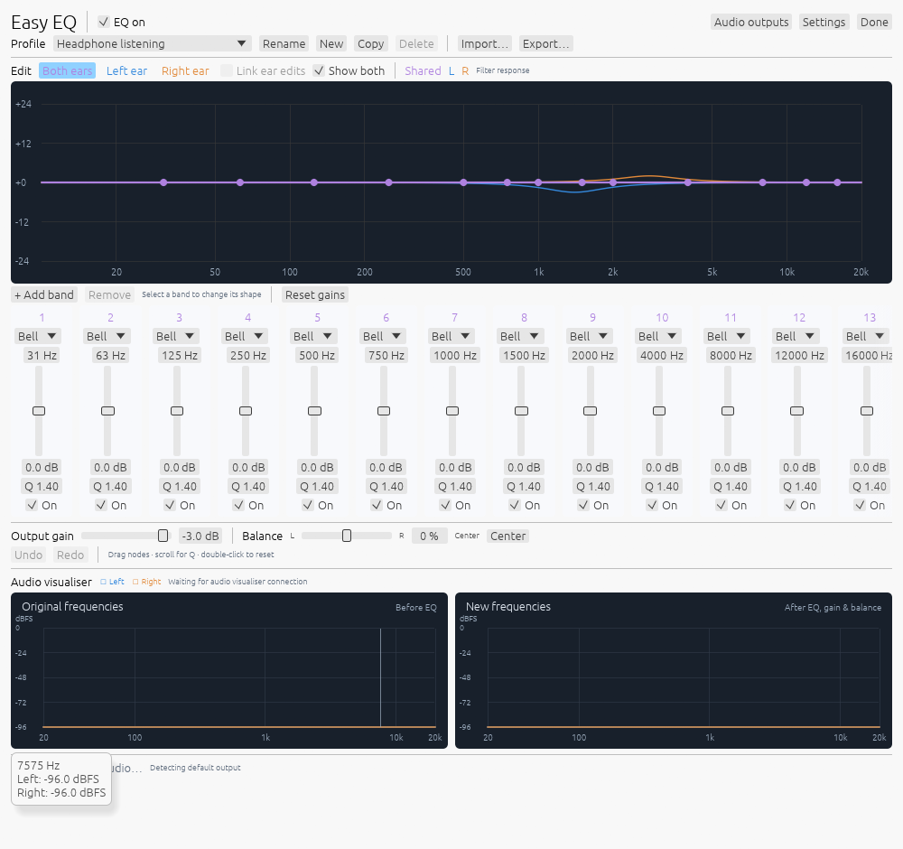

# Easy EQ

A simple Windows EQ frontend for Equalizer APO, with shared tuning and independent left/right correction. Built for balanced everyday headphone listening without an added audio processing buffer.

## Why I built it

I wanted a simple, stable, easy-to-use EQ for Windows to balance my hearing loss. My ears need different adjustments at different frequencies; a single left/right volume slider cannot do that. I wanted games, music and everyday audio to stay responsive, with no added processing-buffer latency and the broadest practical compatibility.

The idea started with per-ear frequency balancing in September 2026. While using Peace with Equalizer APO, I found that stacked always-active profiles could make a supposedly neutral setup sound uneven. That experience shaped this project's priorities: visible controls, predictable profiles, independent ear adjustments, and an on/off state that stays as I left it.

The working prototype was called **Peace 2**. It became **Easy EQ** to give this independent project its own name. The editor was rebuilt in native Rust so normal use needs no browser, webview, Node process or development server.

## Features

- **Both ears, Left ear, Right ear:** shared EQ followed by separate correction for each ear.
- **Editable graph:** drag nodes or enter frequency, gain and Q; bell and low/high-shelf filters.
- **Manual gain and stereo balance:** attenuate one channel without mixing the stereo signals.
- **Profiles per output:** follow the Windows default output and remember its profile, or use one shared profile. New outputs start flat.
- **Linked or independent edits:** copy between ears, undo/redo and import/export JSON profiles.
- **Live before/after spectra:** original/processed left/right traces from actual audio callbacks; capture pauses when hidden.
- **Tray operation:** Close and Done hide the editor while EQ continues. Off bypasses; Quit stops both processes.
- **Automatic recovery:** watchdog restores a crashed or stalled editor; sign-in, unlock and wake triggers preserve availability and the saved on/off state.
- **Accurate status:** discovery, installed effects and acknowledged processing are reported separately.

## Install

1. Download the Windows x64 setup executable from [Releases](https://github.com/AndyParka/easy-eq/releases).
2. Run setup normally. Audio setup requests administrator approval; the editor runs as your normal user.
3. If Equalizer APO is missing, its bundled official installer opens. Select your playback output in Device Selector. A newly configured device may need a Windows restart.
4. Play audio and check that Easy EQ reports active processing. Adjust **Both ears** for common tuning, then **Left ear** and **Right ear** for individual corrections.

Setup installs the editor, audio bridge, recovery task, Start menu shortcuts and uninstaller. A desktop shortcut is optional. To retry audio setup or configure another output, run **Set up audio** from the Start menu. Errors are logged in `%LOCALAPPDATA%/Easy EQ/setup-audio.log`.

Existing APO configuration is backed up and preserved. Disable filters from another EQ to avoid stacking adjustments. Uninstall removes the managed include and startup task while retaining profiles and the separately installed Equalizer APO dependency. Existing Peace 2 profiles remain in `%APPDATA%/technology.parkinson.peace2` for compatibility.

## Scope and compatibility

The first release targets **Windows 10/11 on x64 PCs**, using Equalizer APO's shared-audio effects path. Easy EQ supplies its own Rust DSP component; Equalizer APO connects it to system playback. The original Peace app is not required.

**No added processing buffer:** minimum-phase IIR filters process the current sample and the adapter reports zero added delay frames. This does not mean zero total latency. Windows, hardware, Bluetooth and filter phase/group delay still contribute their own behavior.

Broad compatibility is the goal. ASIO, exclusive/raw playback, disabled enhancements and some spatial paths can bypass APO. Multichannel devices receive front L/R processing; full surround-renderer correction is unverified. Stereo shared playback has been validated on the development machine. See [validation](docs/validation.md) for evidence and remaining checks.

This release is a manual listening EQ. Automated hearing tests, prescribed correction, comfort-tuning tools, macOS/Linux system-audio adapters, and complete ASIO/spatial integration are outside its current scope.

## Background operation

A small watchdog supervises the native tray/editor process. It has no GPU context and restores the editor after exit or a stalled audio-control heartbeat. An expired control lease fades to pass-through so a failed host does not mute Windows audio.

Task Scheduler runs recovery in your signed-in session with no execution-time limit, battery restriction or idle requirement. It starts the app after sign-in, unlock or wake and retries a failed watchdog. The PC can sleep normally; processing resumes after wake.

**Settings → Start in tray at Windows sign-in** controls recovery. Quit stops both processes until the next launch or recovery trigger. Logs rotate at approximately 2 MB in the profile directory.

## Build and verify

Install Rust/MSVC, Visual Studio C++ Build Tools and Inno Setup 6 or 7:

~~~powershell
./scripts/build-installer.ps1
~~~

The build uses locked dependencies, statically links the MSVC CRT and verifies the bundled official Equalizer APO installer's SHA-256 and executable format. Output is in `artifacts/release`. The TypeScript/Tauri prototype remains as development history; the released application uses Rust.

~~~powershell
./scripts/rust.ps1 test --manifest-path crates/easy-eq-core/Cargo.toml --locked
./scripts/rust.ps1 test --manifest-path crates/easy-eq-bridge/Cargo.toml --locked
./scripts/rust.ps1 test --manifest-path crates/easy-eq-devices/Cargo.toml --locked
./scripts/rust.ps1 test --manifest-path crates/easy-eq-desktop/Cargo.toml --locked
./scripts/build-audio.ps1
./scripts/rust.ps1 test --manifest-path crates/easy-eq-vst/Cargo.toml --locked
./scripts/verify-recovery.ps1
~~~

The live callback harness `scripts/verify-native-audio.ps1` also needs the bridge inspector and silent-playback helper built. It restores saved profiles afterward. Actual suspend/resume, audible A/B, driver-specific behavior and a clean-machine install require hardware/manual validation.

## License and credits

GPL-2.0-or-later; see [LICENSE](LICENSE). Easy EQ is independent of Peace and Equalizer APO. Thanks to Jonas Thedering for Equalizer APO and Peter Verbeek for Peace, which inspired the initial exploration.

See [third-party notices](docs/THIRD-PARTY-NOTICES.md), [origin and scope](docs/origin-and-scope.md), [architecture](docs/architecture.md) and [decisions](docs/decisions.md). Matching Equalizer APO source accompanies releases that bundle its installer.
